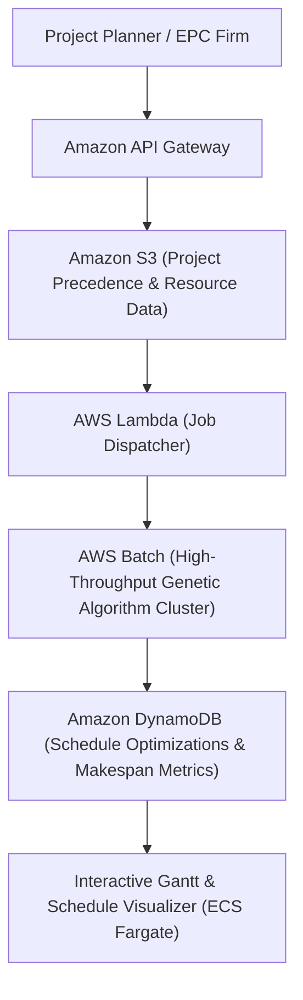

# OptiSchedule — AI-Enhanced Metaheuristic Project Scheduling (RCPSP)

> Resource-Constrained Project Scheduling Problem (RCPSP) optimization engine combining genetic algorithms, constraint satisfaction, and neural hyper-heuristic control.

---

## 1. Executive Brief
Large-scale infrastructure and software projects suffer from multi-million dollar delays caused by resource contention. **OptiSchedule** solves the NP-hard Resource-Constrained Project Scheduling Problem using deep reinforcement and neural-guided metaheuristics to minimize total project makespan under strict precedence constraints.

* **Preservation**: Academic paper research and original code preserved on [`Ex`](https://github.com/prak05/OptiSchedule-RCPSP-AI/tree/Ex).
* **Architecture**: Containerized AWS Batch computing jobs with S3 scenario vaults and interactive Gantt scheduling visualizer.

---

## 2. AWS Cloud Architecture

---

## 3. Branch Architecture
* [`main`](https://github.com/prak05/OptiSchedule-RCPSP-AI/tree/main): High-performance scheduling engine with AWS Batch configuration.
* [`Ex`](https://github.com/prak05/OptiSchedule-RCPSP-AI/tree/Ex): Preserved academic prototype and paper artifacts.

<!-- antigravity-certified -->
